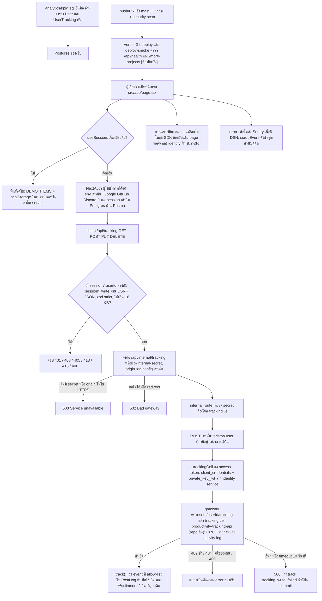
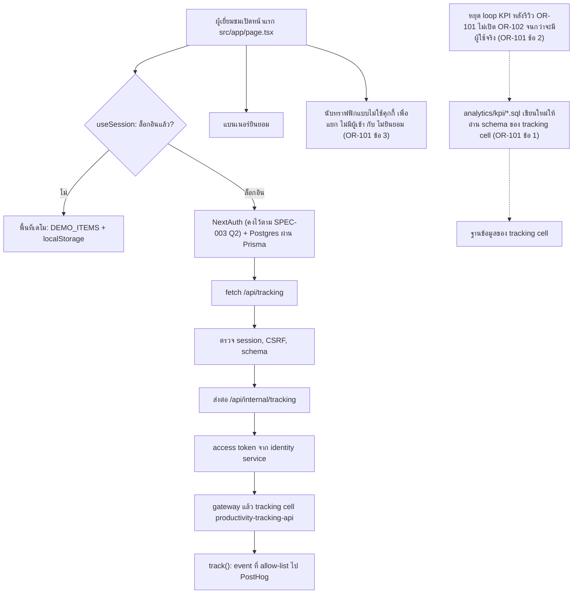

# 01 — Business process (As-Is / To-Be)

productivity-tracking-web (TrackIt) คือเว็บติดตามรายการสื่อหลายประเภท (อนิเมะ มังงะ หนัง หนังสือ เกม ฯลฯ) ส่วนตัว ผู้ใช้ที่ยังไม่ล็อกอินเห็นพื้นที่เดโมที่เก็บใน localStorage ส่วนผู้ล็อกอิน (NextAuth) อ่านเขียนรายการผ่าน `/api/tracking` ซึ่งส่งต่อไปยัง tracking cell หลัง gateway เว็บเองเก็บเฉพาะข้อมูลล็อกอินใน Postgres ผ่าน Prisma และส่ง analytics เฉพาะเมื่อเปิดใช้และผู้ใช้ยินยอม

Last reviewed: 2026-11-28 · commit `a9bd186`

## As-Is (จากโค้ดวันนี้)

Sources: `src/app/page.tsx`, `src/app/api/tracking/route.ts`, `src/app/api/internal/tracking/route.ts`, `src/lib/tracking-cell.ts`, `src/lib/auth.ts`, `src/lib/prisma.ts`, `prisma/schema.prisma`, `src/lib/analytics.ts`, `src/lib/browser-analytics.ts`, `src/components/analytics/analytics-provider.tsx`, `src/lib/sentry.ts`, `analytics/kpi/*.sql`, `scripts/deploy-smoke.sh`, `.github/workflows/deploy-smoke.yml`, `specs/003-tracking-cell/spec.md`, `AUTH.md`

ข้อเท็จจริงเพิ่มเติมจากโค้ด: `src/app/api/mcp/route.ts` เป็นโครง MCP ที่ `tools/call` ตอบข้อความ placeholder ("Implement your tracking logic here") ไม่ได้เรียกข้อมูลจริง

## To-Be (OUTCOME-REVIEW-001 และ SPEC-003)

Sources: `docs/measurement/OUTCOME-REVIEW-001.md` (Decisions and actions, decided 2026-11-26), `specs/003-tracking-cell/spec.md` (Q2: keep NextAuth)

## Gap

| ID | As-Is → To-Be | Status | Owner | Evidence |
|---|---|---|---|---|
| G1 | KPI SQL อ่านตาราง `UserTracking` เดิมที่ schema Prisma ไม่มีแล้ว → เขียนใหม่ให้อ่าน schema ของ tracking cell | todo | claude | `docs/measurement/OUTCOME-REVIEW-001.md` ข้อ 1 (due 2026-12-05, `outcome-review/OR-101#1`); `analytics/kpi/KPI-O-01-weekly-active-trackers.sql` |
| G2 | แยก ไม่มีผู้เข้า ออกจาก ไม่ยินยอม ไม่ได้ เพราะ analytics ฝั่งเบราว์เซอร์ต้องยินยอมก่อน → มีตัวนับทราฟฟิกแบบไม่ใช้คุกกี้ | todo | owner | `docs/measurement/OUTCOME-REVIEW-001.md` ข้อ 3 (due 2026-12-05, `outcome-review/OR-101#3`) |
| G3 | วัด KPI ต่อด้วย event และ SQL → หยุด loop KPI หลังรีวิวนี้ คง TrackIt เป็นเดโมในพอร์ตโฟลิโอ | todo | owner | `docs/measurement/OUTCOME-REVIEW-001.md` ข้อ 2 (due 2026-11-30, `outcome-review/OR-101#2`) |

## Open questions

- SPEC-003 AC-04 กำหนดให้ tracking cell เปลี่ยน origin lock จาก `report` เป็น `enforce` หลังหนึ่งสัปดาห์ ส่วน Implementation (2026-11-12) บันทึกไว้ว่า `report`: โหมดปัจจุบันของ cell อยู่นอก repo นี้ ยืนยันจากโค้ดไม่ได้ [ต้องยืนยัน]
- `PRODUCT.md` (Status 2026-10-23) ยังบอกว่าไม่ได้ deploy จาก main และ `/api/auth/session` บน production ตอบ 404 ส่วน `docs/measurement/GO-LIVE.md` บันทึก redeploy 2026-10-26: สถานะ production และการล็อกอินจริงยืนยันจากโค้ดไม่ได้ [ต้องยืนยัน]
- `specs/README.md` ยังเขียนว่า SPEC-001 "approved, in progress" แต่ตัว spec ระบุ implemented: เอกสารไม่ตรงกัน
- repo นี้มี autopilot (`.github/workflows/autopilot.yml`, `.autopilot/`) ที่รัน loop งาน/รีวิว/merge ตามเวลา: ไม่อยู่ใน diagram เพราะเป็นกระบวนการพัฒนา ไม่ใช่กระบวนการของผลิตภัณฑ์; ยังเปิดอยู่หรือไม่ [ต้องยืนยัน]
